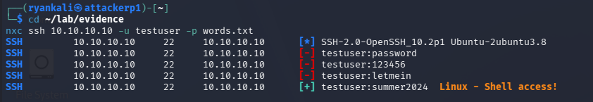
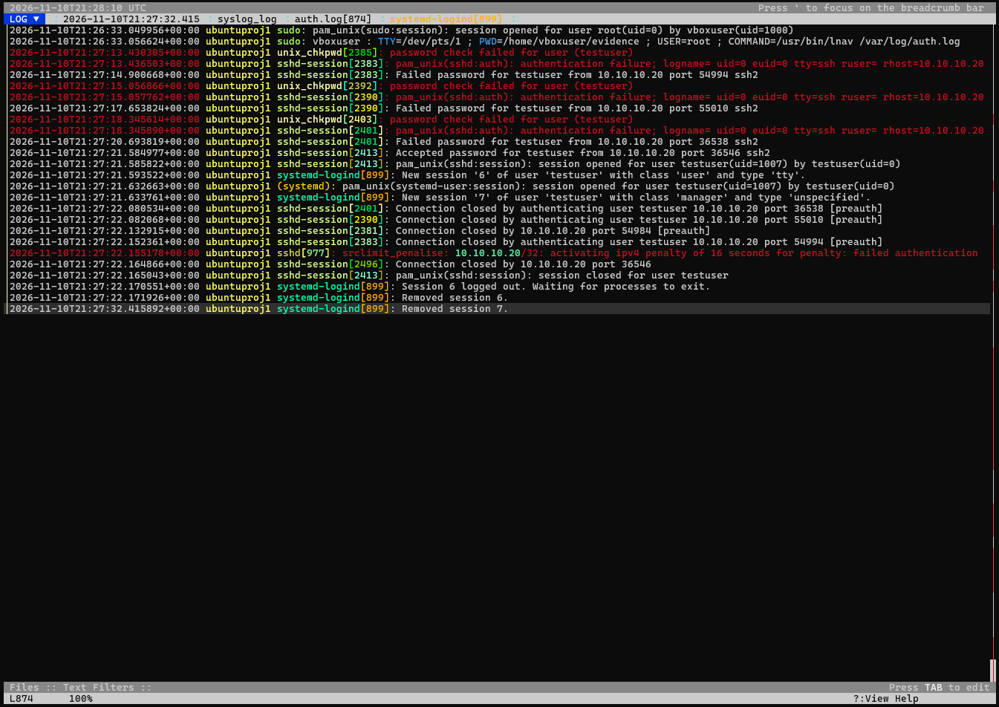
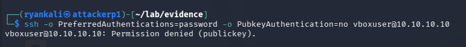

# SSH Brute-Force Attack: Detection & Hardening Home Lab

A hands-on security lab built in VirtualBox to practice the full lifecycle of a common real-world attack: simulate an SSH credential brute force against a Linux server, detect it through log analysis, harden the server so the attack fails, and verify the fixes by re-running it.

> **Lab-only project.** All activity took place between two VMs I own, on an isolated private network. Never run these techniques against systems you do not own.

---

## Summary

A Kali attacker VM ran a dictionary brute force against SSH on an Ubuntu Server target and compromised a weak account (`testuser`) in **7 seconds**, after 3 failed guesses. I detected the attack from `/var/log/auth.log`, built an incident timeline, and assessed impact. I then hardened the host with key-based authentication, a host firewall, and fail2ban, removed the compromised account, and verified the fixes: the identical attack now fails on every guess, password authentication is refused, and the attacker's IP is automatically banned.

---

## Lab environment

| VM | Role | OS | Lab IP |
| --- | --- | --- | --- |
| Target | Server being defended | Ubuntu Server 26.04 LTS | 10.10.10.10 |
| Attacker | Scans and attacks | Kali Linux | 10.10.10.20 |

**Network design.** Each VM has two adapters: a NAT adapter for internet access, and an Internal Network (`lab`) carrying traffic between the two VMs on fixed `10.10.10.x` addresses. This keeps all attack traffic isolated from any real network.

**Tools:** VirtualBox, nmap, NetExec (`nxc`), lnav, OpenSSH, UFW, fail2ban, Bash, cron.


---

## 1. Reconnaissance

From Kali, I scanned the target to see it the way an attacker would:

```
nmap -sn 10.10.10.0/24        # host discovery
nmap -sV -sC 10.10.10.10      # service and version detection
```

Result: **only one port open — 22/tcp (SSH)**, running `OpenSSH 10.2p1 Ubuntu-2ubuntu3.8`. The SSH software was current with no obvious exploit, which pointed to the realistic attack path: **guessing a weak password** rather than exploiting the service. This directly justified the brute-force approach.

---

## 2. Attack

From Kali, using a small wordlist of common passwords against the target account:

```
nxc ssh 10.10.10.10 -u testuser -p words.txt
```

The tool cracked the password after three failed guesses:

```
[-] testuser:password
[-] testuser:123456
[-] testuser:letmein
[+] testuser:summer2024   Linux - Shell access!
```



---

## 3. Detection & analysis

I investigated `/var/log/auth.log` on the target, scoping the search to the incident's time window (the log also contained an older test, a reminder that logs accumulate and must be filtered to the event).

**Indicators of compromise:** 3 failed logins from a single IP across different source ports, immediately followed by an accepted login from that same IP — an automated tool, not a human.

### Incident timeline (UTC)

| Time | Event |
| --- | --- |
| 21:27:14 | First failed password for `testuser` from 10.10.10.20 |
| 21:27:17 | Second failed attempt |
| 21:27:20 | Third failed attempt |
| 21:27:21 | **Accepted password — account compromised** |

**Source:** 10.10.10.20 | **Target account:** `testuser` | **Time to compromise:** ~7 seconds.

**Impact assessment:** `testuser` had no `sudo` rights and belonged to no privileged group, so the breach was contained to one low-privilege account. Had the attacker cracked an admin account instead, the result would have been full server compromise — the reason even "unimportant" accounts with weak passwords are dangerous.



Evidence was hashed with `sha256sum` after collection as a basic chain-of-custody step.

---

## 4. Remediation

| Control | Change | Why |
| --- | --- | --- |
| SSH authentication | `PasswordAuthentication no` (key-based only) | Keys cannot be brute-forced |
| Root login | `PermitRootLogin no` | Removes the most-targeted account |
| Auth attempts | `MaxAuthTries 3` | Limits guesses per connection |
| Host firewall (UFW) | Allow port 22 only from 10.10.10.20 | Only one trusted host can reach SSH |
| fail2ban | Ban after 3 failures for 10 min | Automatically blocks guessing attacks |
| Compromised account | Deleted `testuser` | Closes the attacker's known credential |

**Before / after (`sshd -T`):**

```
before:  passwordauthentication yes   permitrootlogin without-password   maxauthtries 6
after:   passwordauthentication no    permitrootlogin no                 maxauthtries 3
```

> In a real incident I would *lock* a compromised account and investigate before deleting it, to preserve forensic artifacts. Deleting was appropriate here because `testuser` was disposable bait and evidence had already been collected.

---

## 5. Verification

Re-running the **identical** attack after hardening:

```
[-] testuser:password
[-] testuser:123456
[-] testuser:letmein
[-] testuser:summer2024     <-- the password that worked before now fails
[-] testuser:qwerty
```

Two defenses fired:

1. **Authentication** — every guess failed (account deleted, password auth disabled). A forced password login returned `Permission denied (publickey)`.
2. **fail2ban** — after 3 failures the attacker's IP was banned automatically:
   ```
   [sshd] Ban 10.10.10.20
   Banned IP list: 10.10.10.20
   ```

This is **defense in depth**: even if the password had been guessable, the firewall and fail2ban would have stopped the attacker. A final `nmap` scan confirmed exposure was unchanged at the network layer (SSH still reachable from the one allowed host) — the hardening worked at the authentication and host layer, not by closing ports.



---

## 6. Automation

A Bash script (`scripts/ssh_report.sh`) summarizes failed logins, top source IPs, successful logins, and current fail2ban bans. It is scheduled via cron to run daily:

```
0 8 * * * /home/vboxuser/ssh_report.sh >> /var/log/ssh_report.log
```

This turns the manual Phase 4 log analysis into monitoring that runs on its own.

---

## Lessons learned

- **Know which machine you're on.** Early mistakes came from running attacker commands on the target and vice versa. Checking the prompt before every command fixed it.
- **Logs persist.** A restored snapshot retained a prior test's log entries, so I scoped the analysis to the incident timestamp — logs must be filtered to the event under investigation.
- **The `sudo` self-match trap.** `sudo` logs every command, so a naive `grep "Failed password"` matches your own search command; filtering to `sshd` lines avoids false hits.
- **`Connection refused` vs `Permission denied`.** After hardening, a refused connection was not a bug — it was fail2ban working, banning the attacker before SSH even answered.
- **Capture as you go.** Using `script` and `tee` to save output during the work, rather than reconstructing it afterward, is the difference between easy and painful documentation.

## Next steps

- Forward logs to a SIEM (Wazuh or Splunk) for dashboards and alerting
- Add a Windows VM and analyze its Event Logs (Event ID 4625 = failed logon)
- Capture the attack traffic with Wireshark for packet-level analysis

---

## Skills demonstrated

Linux administration · VirtualBox networking · nmap · NetExec · log analysis · incident timeline & documentation · SSH hardening · UFW · fail2ban · Bash scripting · cron · chain-of-custody basics
